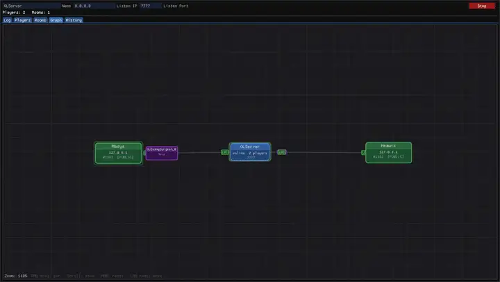

# OpenOL Relay

<p align="center">
  <a href="./README.md">🇺🇸 English</a> /
  <a href="./README_RU.md">🇷🇺 Русский</a>
</p>



TUI/GUI - Relay between [OpenOL](https://github.com/ShyKiss/OpenOL) clients — a modded client for the game Outlast.

Relay is the UDP server of an OpenOL game. It decides what happens to the shared world (doors, triggers, checkpoints), checks what players report, and sends the result to everyone in the room. It doesn't run the game engine: enemy AI runs on one of the players or in a separate headless simulator, chosen by the relay.

To build it, see [docs/BUILD.md](./docs/BUILD.md). To run it in a container, see [docs/HOSTING.md](./docs/HOSTING.md).

## Features

- **UDP server** for 128 clients and up to 64 rooms
- **Encrypted traffic**, and a server key that clients remember so nobody can impersonate the server
- **Rooms** with or without a password. Passwords aren't sent over the network, and only their hashes are stored
- **Bans** — global and per-room, with a reason
- **World sync** for players who join later: player, door, enemy and pickup states
- **Door priority per player** — while one player is interacting with a door, the others get a denial (`DOOR_DENY`)
- **Settings storage** in `relay.db` (JSON) next to the executable
- **Two interface types**: TUI (console with a scrolling log and an input line) and a GUI built on ImGui
- **Packet rate limiting** and automatic timeout of inactive clients

## Configuration

All settings are stored in the `relay.db` file (JSON format), which is created next to the executable. Rooms, password hashes and bans are kept there as well:

```json
{
  "config": {
    "name": "OLServer",
    "ip": "0.0.0.0",
    "port": "7777"
  },
  "rooms": [
    {
      "code": "PUBLIC",
      "password": "",
      "trusted": [],
      "bans": []
    }
  ],
  "bans": []
}
```

The file is rewritten when settings are changed through commands/GUI and on server shutdown. The `trusted` list is no longer used.

The server key is stored separately in `relay.db.key`. Keep this file: see [docs/HOSTING.md](./docs/HOSTING.md).

## Commands

Available both in the TUI and in the input field on the **Log** tab in the GUI.

| Command | Description |
| --- | --- |
| `list` | List players per room |
| `rooms` | List active rooms |
| `kick <id>` | Kick a player |
| `ban <id> [reason]` | Global ban by the player's IP |
| `ban room <code> <id> [reason]` | Ban a player in a specific room |
| `unban <ip>` | Remove a global ban |
| `unban room <code> <ip>` | Remove a ban in a room |
| `bans` | List all bans |
| `room create <code> [password]` | Create a room |
| `setpw <code> <password>` | Change a room's password |
| `stats` | Server key, traffic, refused joins, and each player's connection |
| `log on\|off` | Toggle packet logging |
| `quit` | Shut down the server |

## Built with

| Project | Purpose |
| --- | --- |
| [OpenOL](https://github.com/ShyKiss/OpenOL) | The modded Outlast client this Relay is made for |
| [Dear ImGui](https://github.com/ocornut/imgui) | Graphical interface (GUI build) |
| [SDL2](https://github.com/libsdl-org/SDL) | Window and input for the GUI build on Linux/macOS |
| [Monocypher](https://monocypher.org) | Encryption and password hashing |
